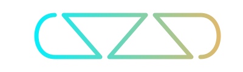

  

<h1 align="center">A S Z S D</h1>

  <b>Architectural Systems &middot; Audiophile DSP &middot; Android Low-Level Engineering &middot; Creative Tech</b>

  
  

---

### 🧬 About The ASZSD Ecosystem
Welcome to the personal engineering laboratory of **Sireesh**. Here, low-level Android frameworks, Linux audio HALs, DSP pipelines, and precision micro-UIs intersect.

* **Soniq DSP**: Bit-perfect Harman acoustic calibration, low-latency audio pipelines, and organic dynamic visualizers for HyperOS & Samsung Galaxy Buds 2 Pro.
* **Aether Architecture**: Systems engineering, hardware interaction tools, and custom firmware bridges.

---

### 🎨 Brand & Design Assets
The official **ASZSD** continuous monogram vector assets are maintained directly within this repository:
- [`aszsd_monogram.svg`](./aszsd_monogram.svg) — Web & GitHub High-DPI Vector
- [`aszsd_monogram.xml`](./aszsd_monogram.xml) — Android AAPT Vector Drawable

---

  Engineered with precision &middot; &copy; 2026 ASZSD // Sireesh

